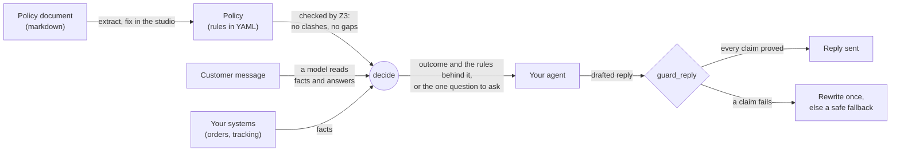

# policyproof

Prove what an agent may decide and say, from a written policy.


<sub>The studio finds where a refunds policy contradicts itself and asks its author about one example customer at a
time, in plain words.</sub>

An AI support agent that grants refunds, rebooks flights or approves returns is only as trustworthy as the policy
behind it, and a language model asked to "follow the policy" will sometimes decide the wrong outcome or promise
something the policy never allowed. `policyproof` takes those decisions away from the model. The policy is written as
rules that the [Z3](https://github.com/Z3Prover/z3) solver can reason about, and every decision is proved from them:

- **Decide, or ask the one question that settles it.** Given the facts you know about a customer, `policyproof`
  either proves the outcome (and names the rules and facts that prove it) or picks the single question whose answer
  would decide the case.
- **Check the policy itself.** Before anything runs, it finds rules that contradict each other and customers no rule
  decides, each shown as a concrete example customer.
- **Guard what the agent says.** Models read the customer's messages and draft the replies, but every claim in a
  drafted reply is checked against the proof before it is sent, and anything that can't be checked falls back to a
  plain safe reply.
- **Start from the document you already have.** The authoring layer turns a markdown policy into rules, and the
  studio, a local web page, lets the person who owns the policy fix contradictions and gaps in plain English, without
  reading logic.

The core is pure and deterministic: no LLMs, no network, no I/O. Models are optional and only ever read text.

> **Status:** early (0.1, pre-release). The API may still change.

## How it works



Models only ever read text: what the customer said, and what a drafted reply claims. Every decision comes from the
rules, and every claim is checked against them.

## Getting started

`policyproof` needs Python 3.13 or later.

```bash
uv add "policyproof @ git+https://github.com/javergar/policyproof"
# or: pip install "policyproof @ git+https://github.com/javergar/policyproof"
```

### 1. Write a policy

A policy is a YAML file: typed variables (known from a system, asked of the customer, or derived by the rules), rules,
and the outcomes a case can end in. Save this as `refunds.yaml`:

```yaml
policy: late-parcels
version: "1"
variables:
  daysLate: { sort: Int, role: system, description: Days the parcel arrived after the promised date. }
  wantsRefund:
    sort: Bool
    role: ask
    question: Would you like your money back?
    description: The customer wants a refund rather than a voucher.
  refund: { sort: Bool, role: derived, description: The customer gets a refund. }
  voucher: { sort: Bool, role: derived, description: The customer gets a voucher. }
rules:
  - { id: R1, when: { and: [{ ge: [daysLate, 2] }, wantsRefund] }, then: refund }
  - { id: R2, when: { and: [{ ge: [daysLate, 2] }, { not: wantsRefund }] }, then: voucher }
  - { id: R3, when: { lt: [daysLate, 2] }, then: { and: [{ not: refund }, { not: voucher }] } }
  - { id: R4, when: refund, then: { not: voucher } }
  - { id: R5, constraint: { ge: [daysLate, 0] } }
outcomes:
  refund: { refund: true }
  voucher: { voucher: true }
  nothing: { refund: false, voucher: false }
```

[`policy.schema.json`](src/policyproof/schema/policy.schema.json) is its JSON Schema, for completion in your editor.

### 2. Decide a case

```python
from pathlib import Path

from policyproof.core.codec import from_yaml
from policyproof.core.decide import decide
from policyproof.core.facts import Answered, Fact, FromSystem, facts
from policyproof.core.solver import compile
from policyproof.core.syntax import BoolLit, IntLit
from policyproof.core.validate import gate

policy = from_yaml(Path("refunds.yaml").read_text()).unwrap()
compiled = gate(compile(policy)).unwrap()   # fails if the policy has errors

late = Fact("daysLate", IntLit(3), FromSystem("tracking"))
print(decide(compiled, facts(late)))
# NeedInfo(var='wantsRefund', question='Would you like your money back?', reason='missing',
#          what_if=((BoolLit(value=True), 'refund'), (BoolLit(value=False), 'voucher')))

yes = Fact("wantsRefund", BoolLit(True), Answered("Would you like your money back?", "yes please"))
print(decide(compiled, facts(late, yes)))
# Decided(outcome='refund', rules=('R1',), facts_used=(...))
```

With only the delivery date known, the case can't be decided yet, so `decide` returns the one question to ask and
what each answer would lead to. Once the customer answers, it proves the refund and names rule R1 as the reason.

### 3. Catch a contradiction

Add a rule that clashes with R1, say `{ id: R6, when: { ge: [daysLate, 10] }, then: { not: refund } }`, and `gate`
refuses the policy, showing the customer the rules can't agree on:

```text
<Failure: (NotTotal(witness={'daysLate': IntLit(value=10), 'wantsRefund': BoolLit(value=True)}), ...)>
```

A parcel 10 days late whose customer wants their money back has no possible outcome: R1 says refund, R6 says no
refund.

### 4. Try the studio

The studio is where a policy author fixes problems like that one in plain English ([see it step by
step](#fix-a-policy-in-the-studio)). Try it with no model and no account, using a sample policy and scripted
stand-ins for the model (the Z3 checks are real):

```bash
git clone https://github.com/javergar/policyproof && cd policyproof
uv sync
uv run python scripts/studio_demo.py
```

### Where next

- [Reading text](#reading-text-policyproofeffects): read customer messages and guard drafted replies with a model.
- [Evaluating a configuration](#evaluating-a-configuration-policyproof-eval): check your readers on your policy
  before deploying.
- [Authoring a policy from a document](#authoring-a-policy-from-a-document-policyproofauthoring) and
  [the studio](#the-studio-policyproof-studio): start from a markdown policy.
- [Examples](#examples): the studio step by step, guarding an agent, testing readers, and a media plan.
- [`tests/policies/`](tests/policies) has larger reference policies (deliveries, retail refunds, flight
  disruption), and [`examples/`](examples) has their markdown documents, eval cases and a whole agent turn.

## Examples

| You want to... | Look at |
|---|---|
| Decide cases and ask the right question | [Getting started](#getting-started) |
| Turn a policy document into rules and fix it, without reading logic | [Fix a policy in the studio](#fix-a-policy-in-the-studio) |
| Stop a support agent promising what the policy doesn't allow | [Guard a support agent](#guard-a-support-agent) |
| Check a model on your policy before deploying | [Test your readers before you deploy](#test-your-readers-before-you-deploy) |
| Use it outside customer service | [Plan a media budget within the guidelines](#plan-a-media-budget-within-the-guidelines) |

### Fix a policy in the studio

The studio is for the person who owns the policy: an operations, service or legal author who has never read a
formula. Open it on a markdown document (`policyproof studio refunds.md --model ...`), or try the demo, which needs no
model: `uv run python scripts/studio_demo.py`.

**1. It finds the problem and shows it as a customer.** "Courier parcels are never refunded" clashes with two other
rules. Rather than showing the logic, the studio shows the customers they disagree on, what each rule says for them
(quoted from the document), and one question: what should this customer get? (The screenshot at the top of this page.)

**2. You answer, and it proposes the smallest change to the document.** Here both customers should get a refund, so
the studio rewrites one sentence, re-reads it, and checks the result with Z3 against every rule and every customer
you've approved before you see it:


**3. Accept, and move on.** The change is written to the document straight away (and can be undone), the two
customers are kept as approved examples that every later change is checked against, and the next thing to look at
comes up:


More in [the studio](#the-studio-policyproof-studio).

### Guard a support agent

Your agent drafts replies as usual. `read_turn` reads the customer's message into facts (an answer is only accepted
if it quotes the message), the policy decides, and `guard_reply` checks every claim in the draft against the proof
before anything is sent:

```python
known = facts(Fact("daysLate", IntLit(3), FromSystem("tracking")))
asked = decide(compiled, known)            # NeedInfo: "Would you like your money back?"

turn = (await read_turn(compiled, Conversation(known, asked, frozenset()),
                        "Yes please, I'd like my money back.", Readers(llm, llm))).unwrap()
turn.decision                              # Decided(outcome="refund", ...)

draft = "Sorry about the delay! Since it was 3 days late, you'll get a voucher."
sent = await guard_reply(compiled, turn.state.facts, turn.decision, draft, llm, llm)
# the voucher claim contradicts the proven refund: the reply is rewritten once and checked
# again, and if it still fails a plain fallback is sent instead
```

[`examples/turn.py`](examples/turn.py) runs this turn end to end on a Bedrock model. Details in
[Reading text](#reading-text-policyproofeffects).

### Test your readers before you deploy

Write cases next to your policy, the way you'd write tests, and check each reader configuration (model, prompts,
Jev) on them. A wrong decision fails the gate; asking again is allowed, within a limit. This calls the models
named in `readers.yaml`:

```bash
policyproof eval examples/eval/toy.cases.yaml --readers examples/eval/readers.yaml --runs 3
```

Details in [Evaluating a configuration](#evaluating-a-configuration-policyproof-eval).

### Plan a media budget within the guidelines

The same machinery works wherever decisions must follow written rules. In
[`examples/marketing_mix/`](examples/marketing_mix) the marketing guidelines (budget caps, TV only with legal
sign-off, launch support, no conversion ads for SKUs about to sell out) are a policy. Z3 finds the most profitable split of a
$1M budget under them, using funnel performance per SKU and channel, and `decide` proves the plan follows them.
Run it with `uv run python examples/marketing_mix/plan.py` (no model needed):

```text
1. The best plan the guidelines allow (predicted margin $288.4k):

                              TV        Social        Search  Retail media       Total
  TrailRunner Pro          $0.0k       $100.0k       $100.0k       $100.0k     $300.0k
  AeroLite                 $0.0k       $150.0k       $100.0k       $100.0k     $350.0k
  Classic Canvas           $0.0k         $0.0k         $0.0k         $0.0k       $0.0k
  Share of budget             0%           25%           20%           20%         65%

  Approved: proved from G1, G2, G3, G4, G5, G6, G7.

2. With legal sign-off, TV opens up: predicted margin $443.6k ($155.2k more):
  ...
  Can't approve yet. Ask: Has legal signed off the TV creative? (yes: Approved; no: Needs revising)

3. Last quarter's plan, checked against the guidelines (with legal sign-off):
  ...
  Breaks G2: No single channel gets more than 40% of the budget.
  Breaks G7: A SKU with fewer than 2 weeks of stock gets no lower-funnel spend.
```

## Reading text: `policyproof.effects`

Models read the text; the policy decides. A turn runs through two pipelines:

- `read_turn` reads the customer's message: the answer to the question asked last turn, and any facts they state.
- `guard_reply` checks a drafted reply's claims against the proof, rewrites it once if it fails, and otherwise sends
  a plain fallback, so unchecked text never reaches the customer.

```python
from pydantic_ai.models.bedrock import BedrockConverseModel   # or any model pydantic-ai supports
from policyproof.effects.llm.readers import LLMReaders
from policyproof.effects.pipeline import Conversation, Readers, guard_reply, read_turn

llm = LLMReaders(BedrockConverseModel("au.anthropic.claude-haiku-4-5-20251001-v1:0"))
turn = (await read_turn(compiled, Conversation(known, pending_question, frozenset()), message,
                        Readers(llm, llm))).unwrap()
sent = await guard_reply(compiled, turn.state.facts, turn.decision, draft, llm, llm)
```

`examples/turn.py` runs a whole turn. Install the readers with an extra, plus your provider's pydantic-ai extra:

```bash
uv add "policyproof[llm]" "pydantic-ai-slim[bedrock]"   # any chat model pydantic-ai supports
uv add "policyproof[jev]"                               # Jev, TypeSafe's decision model (facts and answers)
```

What each part does when something goes wrong (it always errs toward asking again, never toward deciding):

| Situation | Result |
|---|---|
| An answer's quote isn't in the message, its value has the wrong type, or it contradicts an opening "yes"/"no" | `Unclear`: the question is asked again |
| A stated fact can't be quoted, or Jev's confidence is under `min_confidence` (0.5) | the fact is dropped (`Turn.rejected`) |
| A fact Jev scored under `firm_confidence` (0.8) would change the decision | the customer is asked to confirm it |
| The answer reader fails | `read_turn` returns the error |
| The fact reader fails | the turn goes on without volunteered facts (`Turn.degraded`) |
| A reply's claim can't be read, or any check fails twice, or a model call fails | `guard_reply` sends the fallback |

Claims cover the policy's variables only. A reply can still promise something the policy has no variable for (a
callback, a payment method); catch those with the core's domain rules (`forbid`, `only_entities`).

Readers can be combined (`effects.consensus`): `AgreeingFacts(jev, llm)` keeps only facts both found,
`AgreeingAnswers(a, b)` accepts an answer only if both read the same value, and `UnionClaims(a, b)` checks every claim
either found. If one of the two fails, the other's result is used alone (as with a single reader) and a WARNING is
logged on `policyproof.consensus`.

Quotes are matched on letters and digits a to z and 0 to 9 (the core's `normalize`), so text in other scripts
(Chinese, Cyrillic, Arabic, ...) can't be quoted yet: every answer reads as unclear and every reply falls back.

A `Compiled` policy holds a Z3 context: use it from one thread (any number of turns on one event loop is fine).

## Evaluating a configuration: `policyproof eval`

Before deploying, check that your readers are safe on your policy. Write cases next to it: a turn case gives the
known facts, the question pending and the customer's message, and says what must be decided; a reply case gives the
facts and a draft, and says whether the check must catch it.

```yaml
policy: policy.yaml
cases:
  - id: says-yes
    turn: {facts: {daysLate: 3}, asked: wantsRefund, message: "Yes please, I'd like my money back."}
    expect: {decision: refund, facts: {wantsRefund: true}}
  - id: voucher-draft-is-caught
    held_out: true
    reply: {facts: {daysLate: 3, wantsRefund: true}, draft: "You'll get a voucher."}
    expect: caught
```

Name your reader configurations (models are pydantic-ai model strings) and run them:

```bash
policyproof eval cases.yaml --readers readers.yaml --runs 3 --json report.json
```

Every case runs `--runs` times for each configuration. A run is **correct**, **conservative** (it asked again,
escalated, or fell back: safe but unhelpful) or **wrong** (it decided the wrong outcome, misread a fact, or let a bad
draft through), and a case is as bad as its worst run. The gate passes with zero wrong cases and at most
`--max-conservative` (10%) conservative ones, over all cases and over the held-out cases alone. Exit codes: 0 pass,
1 fail, 2 invalid input (checked before any model is called).

Write held-out cases last and don't tune against them. `examples/eval/` has cases for the three reference policies
and a `readers.yaml`. On Bedrock Claude Haiku 4.5 the toy and flight cases pass; the retail held-out case
`unopened-and-cracked` comes out conservative (the model finds "unopened, but the screen is cracked" contradictory
and asks again), which is what a failed gate looks like in practice.

Phrasings help readers recognise answers. Add them to a variable in the policy; they never change a decision:

```yaml
wantsRefund:
  sort: Bool
  role: ask
  question: Would you like your money back?
  phrasings: {true: [money back, a refund], false: [a voucher is fine]}
```

## Authoring a policy from a document: `policyproof.authoring`

Policies are usually written for people, in markdown. The authoring layer turns one into a policy and helps its author
fix what's wrong with it, without reading logic. `policyproof studio` (below) puts it in front of the author.

- **Extraction** (`authoring.llm.LLMExtractor`, any pydantic-ai model, `[extract]` extra): the whole document in one
  pass, every rule linked to the sentence it came from, and the sentences that gave no rule.
- **Problems** (`core.problems.problems`): every clash between rules and every customer no rule decides, each shown
  as a minimal example customer. A gap is also a warning in `validate` (`Undecided`).
- **Plain words** (`authoring.plain`): facts and outcomes through the policy's new `display` phrases ("Came by
  courier", "{} days late", "A refund").
- **Proposals** (`authoring.propose`): the author says what a customer should get; a model drafts the smallest change
  to the document, the changed sentences are extracted again with the policy's own names, and Z3 checks the result
  against every rule and every approved example customer before the author sees it.

`python -m policyproof.authoring.bench --model MODEL DOC CASES [NAMES]` scores an extractor on a document against a
hand-written policy and its eval cases. The reference documents are in `examples/authoring/`.

## The studio: `policyproof studio`

A local page for the person who owns the policy: an operations, service or legal author who has never read a formula.

```bash
pip install 'policyproof[studio]'
policyproof studio delivery-refunds.md --model bedrock:us.anthropic.claude-sonnet-4-5-20250929-v1:0
```

The document sits on the left. On the right is the next thing to decide, always as an example customer in plain
words: what each rule involved says for them, quoted from the document, and one question ("What should this customer
get?"). The author answers; the studio proposes the smallest change to the document's sentences, Z3 checks it against
every rule and every approved example customer, and the author accepts it, rewords it ("Edit the wording" is checked
as they type) or chooses differently. Problems that share a rule are decided together, a change that causes a new
problem says so, and every accept is written to disk straight away and can be undone. Every validator finding is
shown the same way: contradictions, customers no rule decides, sentences nothing was taken from, two names for one
thing, outcomes nobody can get. Warnings can be dismissed with a reason, which is kept; they come back with it if the
rules involved change. When the document is edited in another editor, "Extract again" shows each sentence that now
reads differently and lets the author keep their fix or take the new reading.

Next to `delivery-refunds.md` it keeps `delivery-refunds.policy.yaml`, `delivery-refunds.examples.yaml` (the approved
example customers, each with facts that prove its outcome) and a `.delivery-refunds.studio/` folder (links from rules
to sentences, dismissals and their reasons, the undo history). All plain text, ready for git. The server listens on
127.0.0.1 only and needs the token in the link it prints. Without `--model` it opens a document that already has a
policy and offers everything that needs no model.

`uv run python scripts/studio_demo.py` tries it with no model at all: the couriers policy from the design, with
scripted stand-ins for the drafter and extractor and real Z3 checks.

## Development

```bash
uv sync
uv run ruff check . && uv run ty check && uv run lint-imports && uv run pytest
PP_BEDROCK_MODEL=... TYPESAFE_API_KEY=... uv run pytest -m live   # real models; each test skips without its credentials
PP_UPDATE_SNAPSHOTS=1 uv run pytest tests/unit/test_prompts.py     # after an intended prompt change
uv run pytest --hypothesis-profile=ci     # the laws with 1000 examples each (about 8 minutes)
uv run python -m policyproof.schema       # regenerate policy.schema.json after changing the schema builder
uv run python -m policyproof.studio.schema  # regenerate the studio API's schema after changing studio/wire.py
```

The studio's page is TypeScript (React, with an Elm-style update loop) under `studio/`; the built page ships inside
the package, so only its developers need Node:

```bash
cd studio && npm install
npm run codegen      # the page's types, from the two JSON Schemas
npm test && npm run typecheck
npm run build        # into src/policyproof/studio/static/, which is committed
```

Licensed under Apache-2.0.
