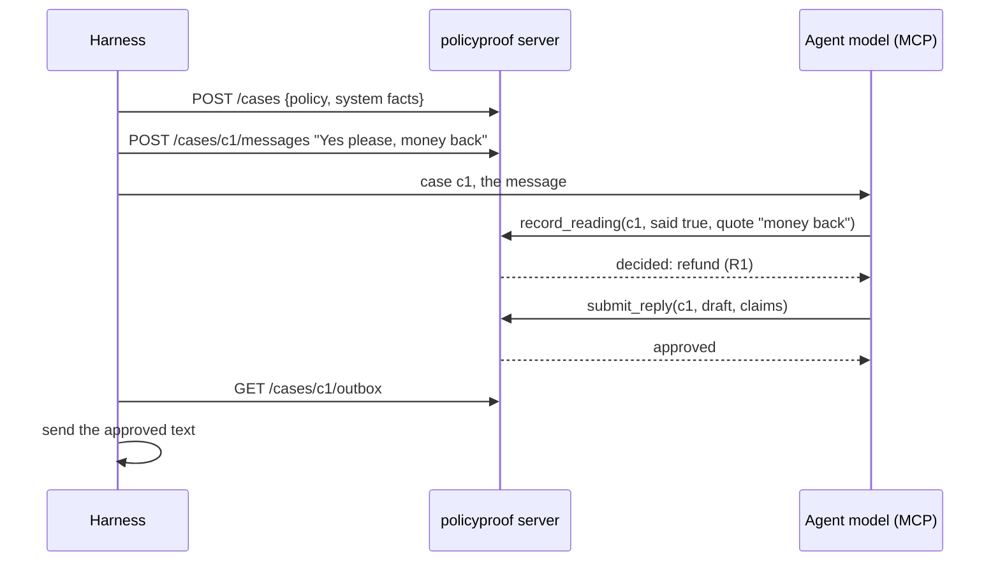

# policyproof MCP server: decisions an agent can call, not make

*2026-11-03. Design spec for review. Builds on milestone 1 (`docs/specs/2026-10-03-core-design.md`), milestone 2
(`docs/specs/2026-10-03-effects-design.md`) and milestone 3 (`docs/specs/2026-10-08-eval-design.md`). Library facts
are from the MCP Python SDK v2 docs (`py.sdk.modelcontextprotocol.io`, v2.3, protocol revision 2026-07-28), checked
in a spike on 2026-11-03 (see Spike results).*

## Purpose

Today an agent uses policyproof by importing it. Most agents are now built on hosts that call tools over the Model
Context Protocol (MCP): Claude, Amp, IDE agents, and the support platforms built on them. They can't import a Python
library, and their builders don't want to.

`policyproof mcp` serves policies over MCP. An agent calls `decide` instead of deciding, asks the one question
policyproof picks, and hands its drafted reply to policyproof before anything reaches the customer. The server is a
FastAPI app. It serves MCP to the agent's model at `/mcp`, and a small REST API to the agent's **harness**: the
ordinary code around the model that knows the customer's account and carries their messages.

The server adds no new reasoning. Every decision and check is the existing core, guards and pipelines, called through
a functional core with a thin imperative shell.

## Goals

- An MCP host with no Python can decide cases, get the one question to ask, and have replies checked, on any policy
  that passes `gate`.
- A model that calls the server can't make a decision the policy doesn't prove, whatever it puts in a tool call.
  It can't override facts from the harness's systems, and it can't record an answer the customer didn't give.
- Cases opened through the harness get the same results as `read_turn` and `guard_reply` given the same readings.
  This is tested as parity, not assumed.
- Every server module except one is free of FastAPI, the MCP SDK and pydantic, and is tested without a server.

## Non-goals

- Authoring over MCP: extracting a document, proposals, the studio's flow. `validate_policy` reports findings; fixing
  them stays in the studio.
- Fetching system facts. The harness sends them; connectors to order or booking systems are the harness's job.
- Accounts, tenants, OAuth and a policy upload API. Policies are files the operator deploys. OAuth is the SDK's
  documented path and can be added later without changing tools.
- Persistent and shared case storage. v1 keeps cases in memory, in one process (see Calls 4).
- Sending replies. The server queues approved text; the harness delivers it.

## Anti-goals

These would make the server a failure even if it worked:

- **A tool that lets the model supply a system fact,** or a fact with a confidence, or an answer whose quote isn't
  in a message the harness recorded.
- **Returning "passed" for a check the solver gave up on,** or a decision from a policy that failed `gate`.
- **Reply text in the outbox that wasn't checked:** everything there passed `check_reply` or is the fallback
  template.
- **A second implementation of the turn rules.** The server calls `read_turn`, `guard_reply` and `check_reply`; it
  doesn't re-implement them, so the library, `eval` and the server can't drift apart.

## Decisions

- **FastAPI hosts everything.** One FastAPI app serves the harness REST API with its OpenAPI docs and mounts the MCP
  SDK's Streamable HTTP app with `app.mount("/", mcp_app)`, after every route, so the endpoint is exactly `/mcp`.
  The app's lifespan enters `mcp.session_manager.run()`, because a mounted app's own lifespan never runs.
- **The official MCP Python SDK, v2, high-level `MCPServer`** (formerly FastMCP). It makes tool input and output
  schemas from type hints, accepts dataclasses, and turns a raised `ToolError` into an `is_error: true` result the
  model can read and act on. Two rules come from the spike: a tool's **return type must not be a slotted
  dataclass**, and **every tool is `async def`** (Spike results 1 and 2).
- **Stateless HTTP with JSON responses** (`stateless_http=True, json_response=True`). Every tool call stands alone.
  The state of a conversation lives in a case, named by its id, not in an MCP session. The server never asks the
  client for anything: no sampling and no elicitation. At 2026-07-28 that back-channel is gone anyway.
- **stdio too, for policy tools only.** `policyproof mcp POLICIES --stdio` serves the stateless policy tools to a
  local host such as Claude Desktop or Amp, for policy authors and developers. Cases need the harness, so they are
  HTTP only.
- **Two audiences, two tokens.** The harness uses `PP_HARNESS_TOKEN` on `/cases`. The agent uses `PP_AGENT_TOKEN`
  on `/mcp`. Both are bearer tokens compared in constant time, as in the studio. On 127.0.0.1 the CLI makes and
  prints them when they aren't set. On any other host it refuses to start without them and needs `--allowed-host`,
  which feeds the SDK's DNS-rebinding allowlist.
- **The caller is the reader by default.** The agent's model already reads every customer message. A case lets it
  report its reading (`record_reading`): the answer with its quote, and any facts the customer stated, quoted. The
  server checks it with the same guards as the LLM readers, against the message text the *harness* recorded. With
  `--readers readers.yaml --config NAME` (the eval file format), the server reads messages and claims itself with
  configured readers, and `record_reading` isn't offered.
- **A case is an event log.** Its state is a fold over its events. Every action is a pure `react(state, command)`
  that returns new events or a refusal (Functional style, below).
- **Style unchanged from milestones 1 to 3:** frozen, slotted dataclasses and closed unions, `match` with
  `assert_never`, `returns` `Result`, protocols as signatures, dependencies passed as arguments, and no
  `flow`/`pipe`/`curry`/`RequiresContext`.

## Trust: who supplies what

| Input | Supplied by | Becomes | Checked by |
|---|---|---|---|
| Policies | the operator, as files at start-up | `Compiled`, after `gate` | `gate`: a policy with errors is refused and the server doesn't start |
| System facts | the harness (`POST /cases`, `POST /cases/{id}/facts`) | `Fact(…, FromSystem(source))` | the core's `fact_errors` |
| Customer messages | the harness (`POST /cases/{id}/messages`) | the transcript | nothing; they are the ground truth quotes are checked against |
| The answer to the pending question | the model (`record_reading`) or the server's readers | `Answered(question, quote)` | `guards.answer.check` against the recorded message |
| Facts the customer stated | the model or the server's readers | `Volunteered(Quoted(text))` | `guards.facts.check`. The wire type has no confidence field, so a caller can't send one |
| A drafted reply and its claims | the model (`submit_reply`) | a `CheckResult` | `guards.claims.check` and `check_reply` |
| Facts and claims in stateless tools | the model | as given | the core only. The model can say anything here (see below) |

What this protects against, and what it doesn't:

- `merge` ranks system facts above answers above volunteered facts. The model can't override what the harness said.
- An answer counts only if its quote is in a message the harness recorded. The model can still misread a message
  whose words are there, but `opening_word` and the sort checks catch the common slips. Server readers, or
  `AgreeingAnswers` of two models, remove this dependence on the caller.
- Reply checks with caller claims catch honest mistakes, not a model that hides a claim. A wrong claim it reports is
  caught. A claim it leaves out isn't, except the outcome itself, which `states_outcome` requires. Production
  deployments should use server readers for claims (`UnionClaims` of two models). Every check result says who read
  it (`checked_by: caller | server:<config>`), and so does the audit log.
- The stateless tools trust their caller completely. They are for developers, authoring agents and harnesses that
  call MCP from code. Their descriptions say so, and a deployment can switch them off with `--cases-only`.

## The MCP surface

Tool descriptions are written for a model and tested as snapshots, like the reader prompts. Each says when to call
it and what to do with each kind of result (for example "Ask the question exactly as written, as the last sentence
of your reply"). The server's `instructions` say the rule that matters: *never decide an outcome yourself; call
`decide` or `case_status`.*

Tools take flat parameters (`decide(policy, facts)`), not one request object: a single dataclass parameter would
appear to the model as `{"req": {...}}`. The edge builds the request dataclass from the parameters.

| Tool | Input | Result | Hints |
|---|---|---|---|
| `list_policies` | none | each policy's name, version, digest, outcomes and one-line description | read-only |
| `describe_policy` | `policy` | each variable in plain words: what it means, its values, and who supplies it ("ask the customer: *Would you like your money back?*", "from your systems"), plus the outcomes | read-only |
| `decide` | `policy`, `facts[]` with provenance `system`, `answered` or `volunteered` | a `Decision` (below), the rules behind it with their `explain` texts, and the facts used | read-only, idempotent |
| `check_reply` | `policy`, `facts[]`, `reply`, `claims[]` (expression trees in the policy format, each with its quote) | passed or not, each claim's status, and the problems in plain words | read-only, idempotent |
| `validate_policy` | `yaml` (at most 256 KB) | each finding with its severity and an example customer where there is one | read-only, idempotent |
| `case_status` | `case` | the current decision, the pending question, the last turn's rejected readings, and the attempts left for the next reply | read-only |
| `record_reading` | `case`, `message` (its index), `answer` (`said` with value and quote, `unclear`, or `not_answered`), `facts[]` (each with a quote) | the turn: the decision, the answer as read, what was rejected and why | self-read mode only |
| `submit_reply` | `case`, `draft`, and `claims[]` in self-read mode | `approved` with the text queued for sending, or `revise` with the problems (first attempt, self-read only), or `fell_back` with the fallback text and why | |

A decision on the wire:

```json
{"kind": "need_info", "var": "wantsRefund", "question": "Would you like your money back?", "reason": "missing",
 "what_if": [{"answer": true, "outcome": "refund"}, {"answer": false, "outcome": "voucher"}]}
{"kind": "decided", "outcome": "refund", "label": "A refund",
 "rules": [{"id": "R1", "explain": "Late by 2 days or more, and the customer wants a refund."}],
 "facts_used": [{"var": "daysLate", "value": 3, "from": {"kind": "system", "source": "tracking"}}]}
```

`contradiction`, `escalate` and `invalid_facts` follow the core's union field for field. Values are JSON: Booleans,
integers, enum values as strings, and reals as decimal strings (`"2.5"`), as in the policy format. They are turned
into literals by `guards.values.literal_for`, which already knows each variable's sort. `label` comes from the
policy's `display` phrases through `authoring.plain` when the policy has them.

**Errors.** A domain result is never an error: `need_info`, `invalid_facts` and `fell_back` are ordinary results.
A request the server can't act on (an unknown policy or case, a stale case, a malformed expression, a tool from
the other mode) is a `Refusal`, raised at the edge as `ToolError` so the model reads `is_error: true` with a plain
sentence. The SDK puts `Error executing tool <name>: ` in front of it, so refusals are written to read well after
that: "Error executing tool submit_reply: the case changed while you were working. Call case_status and try
again." Any other exception reaches the model only as `Error executing tool <name>`, so nothing internal leaks.
Arguments that don't fit the input schema come back as pydantic's validation text, which names the field and is
enough for a model to correct its call. Authentication fails at HTTP (401) before MCP sees the request. Raising
`MCPError` is reserved for protocol violations, which the SDK handles.

## The harness surface (REST)

| Route | Does |
|---|---|
| `GET /health`, `GET /policies` | liveness, and the loaded policies with their digests |
| `POST /cases` `{policy, facts}` | opens a case with system facts, returns its id and first decision |
| `POST /cases/{id}/facts` `{facts}` | adds system facts, for example after a lookup the decision asked for |
| `POST /cases/{id}/messages` `{text}` | records a customer message. With server readers it also reads it and returns the turn |
| `GET /cases/{id}` | the derived state, and the event log for audit |
| `GET /cases/{id}/outbox`, `POST /cases/{id}/outbox/{n}/sent` | approved replies waiting to be sent, and marking one sent |
| `DELETE /cases/{id}` | closes a case |

The harness gives the model only the case id. Delivering only what is in the outbox is what turns "every reply is
checked" from a convention into a property of the deployment.

## A turn, end to end (self-read)



With server readers, `POST /messages` returns the turn and the model goes straight to `case_status` and
`submit_reply`. A reply that fails in self-read mode comes back once as `revise`. The second failure queues the
fallback template, as `guard_reply` would. With server readers, `submit_reply` is `guard_reply`, rewriter included.

## Functional style: a pure core, a thin shell

Four layers, each depending only on the ones above it:

1. **Wire** (`mcp/wire.py`): requests and replies as frozen dataclasses, tagged unions with a `kind`, as in
   `studio/wire.py`. No logic and no pydantic import. FastAPI and the MCP SDK derive their schemas from these
   types, so the REST API, the tool schemas and the code can't disagree. The reply types that tools return are
   `@dataclass(frozen=True)` without `slots=True`, because of the SDK bug in Spike results 1. Everything nested
   inside them stays slotted.
2. **Pure functions** (`convert`, `registry`, `case`): wire to core and back, policies from texts, and the case
   reducer. No I/O, no clock, no ids made up inside.
3. **The shell** (`mcp/tools.py`): one `async` function per tool and route, `(Env, Request) -> Result[Reply,
   Refusal]`. Each loads, runs at most one effect (a store read and write, or a reader or pipeline call) between
   pure steps, and stores. It doesn't import FastAPI or MCP.
4. **The edge** (`mcp/server.py`): the only module that imports FastAPI and the MCP SDK. It closes each shell
   function over `Env`, registers it, and turns a `Failure(refusal)` into `ToolError` or an HTTP status. It holds
   no logic of its own.

`Env` is a frozen dataclass passed as an argument: the registry, the case store, the server readers if any, and
`new_id` and `now` functions, so tests pass fixed ones.

**Cases are folds.** A case's events are the only thing stored:

```python
type Event = Opened | SystemFacts | CustomerSaid | TurnRead | DraftRejected | Approved | Sent
type Command = AddFacts | Say | Read | Draft | MarkSent


def evolve(s: CaseState, e: Event) -> CaseState: ...        # total, no solver calls: events carry their results
def state(events: Sequence[Event]) -> CaseState:
    return reduce(evolve, events, EMPTY)
def react(c: Compiled, s: CaseState, cmd: Command) -> Result[tuple[Event, ...], Refusal]: ...
```

- **Events record results, not only inputs.** `TurnRead` holds the reading, who read it, and the `Turn` it produced.
  Replaying a case never calls Z3 or a guard, and an audit shows what was decided at the time even after an upgrade.
- **`react` is pure and does the checking.** It refuses a reading for a message that wasn't recorded, or that was
  read already, and a third draft. It also refuses a case whose policy digest no longer matches the loaded policy:
  the case can't be continued under different rules.
- **The one async step is the reading.** The shell builds a `Turn` with `read_turn` before calling `react`. In
  server mode it passes the configured readers. In self-read mode it passes `Given` readers, two small classes in
  `case.py` whose `read_answer` and `read_facts` return the caller's raw reading as `Success`. Both modes therefore
  run the same `read_turn`, guards and `decide_robustly`, and parity holds by construction.
- **Replies reuse the pipeline.** Self-read drafts go through `_check` in `effects.pipeline`, made public as
  `check_draft`, with a `Given` claim reader. Server mode calls `guard_reply`.
- **Writes are optimistic.** `append(case, expected_version, events) -> Result[int, Stale]`. On `Stale` the shell
  reloads and runs `react` once more, which is safe because `react` is pure. If it is stale again, the caller gets
  a refusal.

A shell function, without the retry on `Stale`:

```python
async def record_reading(env: Env, req: w.ReadingRequest) -> Result[w.TurnReply, Refusal]:
    match await env.store.load(req.case):
        case Failure(refusal):
            return Failure(refusal)
        case Success(loaded):
            pass
        case _:
            unreachable()
    c = env.registry[loaded.state.policy]
    match ready_to_read(loaded.state, req.message):                       # pure
        case Failure(refusal):
            return Failure(refusal)
        case Success((conversation, text)):
            pass
        case _:
            unreachable()
    given = Given(answer_in(req.answer), facts_in(req.facts))
    turn = (await read_turn(c, conversation, text, Readers(given, given))).unwrap()  # Given never fails
    match react(c, loaded.state, Read(req.message, turn, CALLER)):        # pure
        case Failure(refusal):
            return Failure(refusal)
        case Success(events):
            pass
        case _:
            unreachable()
    return (await env.store.append(req.case, loaded.version, events)).map(lambda _: turn_reply(c, turn))
```

Refusals are values all the way to the edge, which is the only place that turns one into `ToolError` or a status
code.

**Z3 and threads.** A `Compiled` holds a Z3 context that must stay on one thread. Every tool and route is
`async def` and runs on the event loop. The edge never registers a plain `def`, because both FastAPI and the MCP
SDK run those on a worker thread (Spike results 2). A test checks that every registered tool and route is a
coroutine function. Decisions take milliseconds. `validate_policy` can take seconds and compiles text from the
caller, so it runs in a `ProcessPoolExecutor`: it is a pure function from YAML text to wire findings, so it can run
in another process with nothing shared. Scaling means more processes. With a shared store, stateless MCP needs no sticky
sessions.

## Modules (`src/policyproof/mcp/`)

The package name doesn't clash with the SDK's `mcp`: imports are absolute, and only `server.py` imports the SDK.

| Module | Main types and functions | May import |
|---|---|---|
| `wire.py` | requests, replies, `Decision` and `Finding` on the wire, `Refusal` | nothing but the standard library |
| `convert.py` | `facts_in(c, facts) -> Result[Facts, Refusal]`, `decision_out(c, d)`, `findings_out(c, fs)`, `claims_in` | core, guards, `authoring.plain` |
| `registry.py` | `registry(texts: Mapping[str, str]) -> Result[Registry, tuple[LoadError, ...]]`: decode, compile, `gate`, digest | core |
| `case.py` | `Event`, `Command`, `CaseState`, `evolve`, `state`, `react`, `Given` readers | core, guards, `effects.pipeline`, `effects.ports` |
| `store.py` | `CaseStore` protocol (`load`, `append`, `close`), `MemoryStore` with a time-to-live and a cap | `case`, `wire` |
| `tools.py` | `Env`, one shell function per tool and route | the above, `effects.pipeline` |
| `server.py` | `app(env, tokens, security) -> FastAPI`, `mcp_server(env) -> MCPServer` | the above, `fastapi`, `mcp` |
| `cli.py` | `policyproof mcp POLICIES [--readers FILE --config NAME] [--host] [--port] [--stdio] [--cases-only] [--allowed-host …]` | `server`, `eval.config`, `uvicorn` |

New import-linter contracts, in the style of the existing ones:

- *"The MCP server's wire, conversions, registry and cases are pure":* `mcp.wire`, `mcp.convert`, `mcp.registry`,
  `mcp.case` and `mcp.store` may not import `fastapi`, `starlette`, `mcp`, `pydantic`, `pydantic_ai`,
  `effects.llm`, `effects.jev` or any provider SDK.
- *"The MCP shell needs no web server and no model SDK":* the same for `mcp.tools`, except that it may use
  `effects.pipeline`.
- *"Only the MCP server's edge and command import FastAPI and the SDK":* add `mcp` and `fastapi` to the forbidden
  list for every other package, as was done for Starlette. `eval.cli` hands `policyproof mcp` to `mcp.cli`, as it
  does for the studio.

Packaging: a new extra, `mcp = ["mcp>=2.3", "fastapi>=0.162", "uvicorn>=0.35"]`, which upgrades nothing in the
lock (Spike results). Server readers also need `[llm]` or `[jev]`, as in `eval`.

## Laws and tests

| # | Law | Checked by |
|---|---|---|
| M1 | **Stateless parity:** `decide` through the wire equals `core.decide` on the decoded facts, and literals of every sort survive the wire round trip | Hypothesis over `strategies.py` policies |
| M2 | **Case parity:** for any sequence of messages and raw readings, a case's decisions and approved replies equal `read_turn` and `guard_reply` with `tests/fakes.py` readers returning the same readings | Hypothesis |
| M3 | **System facts win:** no sequence of caller commands changes the value of a fact the harness gave | Hypothesis |
| M4 | **Replay:** `state(events)` equals the state the shell held after its last write, and `evolve` is total on every event `react` emits | Hypothesis |
| M5 | **The outbox is safe:** every `Approved` text passed `check_reply` or equals `template(decision)` | Hypothesis |
| M6 | **Refusals don't write:** a `Failure` from `react` leaves the store's version unchanged | Hypothesis |

Beyond the laws:

- MCP end to end through the SDK's in-memory `Client(server)`. REST through `httpx`'s ASGI transport, including the
  case flow, both token checks, and the 421 response for a host that isn't allowed.
- A snapshot of `tools/list`, with names, descriptions and both schemas, updated with `PP_UPDATE_SNAPSHOTS=1`. A
  check that every tool has an output schema goes with it, because the SDK drops one silently (Spike results 1).
- Live, marked `live`: one host model drives the toy policy through `record_reading` and `submit_reply`.

## Spike results (mcp 2.3.0, fastapi 0.162.0, 2026-11-03)

A throwaway server ran the toy policy's real `decide` in a tool. It used frozen, slotted wire dataclasses and a
FastAPI host with the bearer middleware, called through the SDK's `Client` over real HTTP (uvicorn) and in process.
It was run against the latest pydantic and Starlette, and again against the versions in `uv.lock` (pydantic 2.13.5,
Starlette 1.9.0), with the same results.

| Question | Finding |
|---|---|
| 1. Do frozen, slotted dataclasses with a `kind` work as tool input and output? | **Input: yes.** Tagged unions parse into the right arm (`AnsweredFrom` versus `SystemFrom`), and a wrong `kind` is a validation error. **Output: not if the return type is slotted.** The SDK then publishes no output schema and returns no `structured_content`, and logs only at INFO. Its `_create_model_from_class` reads each field's class attribute as the field's default, and on a slotted class that attribute is the slot descriptor. Frozen without slots works. Slotted classes nested inside the reply also work, because pydantic builds those itself. The published schema keeps both arms of a union as `anyOf` with `kind` as a `const`. `kind` isn't in `required`, because it has a default, but it is always sent. |
| 2. Where do tools run? | `async def` tools run on the event loop's thread, where a `Compiled` was used with no trouble. **A plain `def` tool runs on a worker thread** (`anyio.to_thread.run_sync` in `func_metadata.call_fn`), as FastAPI's `def` routes do. So the "async only" rule is needed and gets a test. |
| 3. FastAPI mount, auth, host check, lifespan | `app.mount("/", mcp_app)` after the routes, with the default path, serves exactly `/mcp`, and the routes before it still answer. Mounting at `/mcp` with `streamable_http_path="/"` serves `/mcp/`, and `/mcp` answers with a 307 redirect, so the first form is the one to use. Bearer middleware: 401 without the token. `TransportSecuritySettings`: 421 for a host that isn't allowed. The lifespan entering `session_manager.run()` works. The connection negotiated protocol 2026-07-28, and the server's `instructions` reached the client. |
| 4. `ToolError` | `is_error: true`, but the message has `Error executing tool <name>: ` in front of it. A crash shows the model only `Error executing tool <name>`. A return value that doesn't fit the output schema is also an error, once there is a schema. |
| FastAPI with the same wire types | Request bodies parse into frozen, slotted dataclasses with the right union arm. A wrong `kind` is a 422, and the OpenAPI schema lists both arms. |
| Tool annotations | `ToolAnnotations(read_only_hint=True, idempotent_hint=True)` reach the client. |
| Dependencies | Adding `mcp>=2.3` and `fastapi>=0.162` to `uv.lock` upgrades nothing. It adds 11 packages: `mcp`, `mcp-types`, `fastapi`, `annotated-doc`, `sse-starlette`, `python-multipart`, `pyjwt`, `cryptography`, `cffi`, `pycparser` and `pywin32` (Windows only). `httpx2`, which the SDK client needs, is already in the lock. |

The output schema bug is already reported upstream as
[modelcontextprotocol/python-sdk#3711](https://github.com/modelcontextprotocol/python-sdk/issues/3711), with a fix
that reads defaults from `dataclasses.fields` waiting for a maintainer. Once a release has it, reply types can be
slotted again.

## Calls

These are the spec author's calls, not the user's, and are marked so they can be checked.

1. **Self-read by default.** *(Call.)* Requiring server readers would make the server need a model and credentials
   just to start, and most hosts already have a capable model reading every message. The quote check against the
   harness's transcript keeps the main protection. The weaker reply check is labelled on every result, and the
   README will recommend server readers for claims in production.
2. **Stateless tools stay, and can be switched off.** *(Call.)* They are what a developer tries first, and what an
   authoring agent needs. `--cases-only` removes them where the model talks to customers.
3. **No policy uploads.** *(Call.)* Policies are deployed files that pass `gate` at start-up. `validate_policy`
   checks text but never loads it. Reloading means restarting. Open cases then continue only if their policy's
   digest is unchanged.
4. **Memory store in v1.** *(Call.)* The `CaseStore` protocol and the event shape are designed for a persistent
   store, which needs a codec for events. That codec is the main work of a later SQLite or Postgres store, and is
   left out until someone needs it.
5. **Plain words on the wire.** *(Call.)* `label` and `describe_policy` use `display` phrases where they exist. Names
   stay in the result too, because the model needs them to build claims.

## Build order

1. Wire, conversions, registry, the five stateless tools, the FastAPI app with `/mcp`, stdio, the CLI and tokens.
   Useful on its own to developers.
2. Cases: events, `react`, `evolve`, the memory store, the harness routes, the outbox, self-read `record_reading`
   and `submit_reply`, and laws M2 to M6.
3. Server readers from `readers.yaml`, and the README section.
4. Later, when asked for: a persistent store, OAuth through the SDK, domain reply rules (`forbid`, `only_entities`)
   per policy in the server's configuration, and the Tasks extension for long validations once the SDK supports it.
